# SML Bot — ศูนย์ควบคุมกองทัพบอท AI 24/7

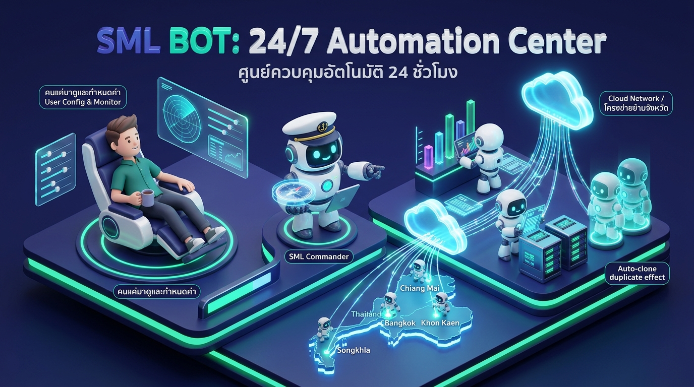

ศูนย์ควบคุมหลัก (Unified Command Center) สำหรับสร้าง สั่งงาน และเฝ้าดูบอท AI ที่รันเป็น Agent Zero VM 24 ชั่วโมงบนเซิร์ฟเวอร์หลัก (Core Engine) ทีมบอทจากต่างสาขา/ต่างจังหวัดส่งงานหากันผ่านโครงข่ายคลาวด์กลาง (Cloud Hub) ได้ โดยไม่ต้องมี Fixed IP

---

## สารบัญ
- [ภาพหน้าจอ](#ภาพหน้าจอ)
- [Objective](#objective)
- [สถาปัตยกรรม](#สถาปัตยกรรม)
- [Workflow](#workflow)
- [Config](#config)
- [Dependency](#dependency)
- [Usage example](#usage-example)
- [API](#api)
- [ความปลอดภัย](#ความปลอดภัย)
- [Limitation](#limitation)

---

## ภาพหน้าจอ

> ทุกภาพเป็นหน้าจอจริงจากระบบที่รันอยู่ (ถ่ายด้วย Playwright, ข้อความตอบกลับมาจาก DeepSeek จริง) ไม่มีภาพจำลอง

### 1. ภาพรวมระบบ — โหมด Monitor (เรดาร์สด)
ผู้บัญชาการ SML (SML Commander) รันรอบงานอัตโนมัติ มีเรดาร์สแกนและฟีดกิจกรรมสด รองรับทั้งโหมดมืดและโหมดสว่าง

| โหมดมืด | โหมดสว่าง |
|---|---|
| 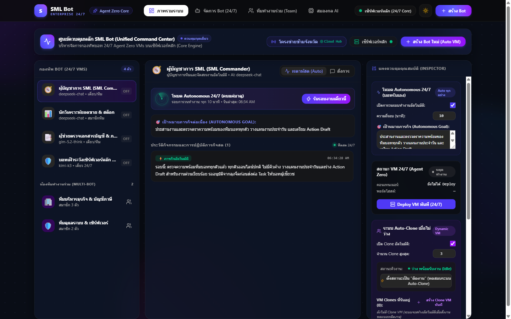 | 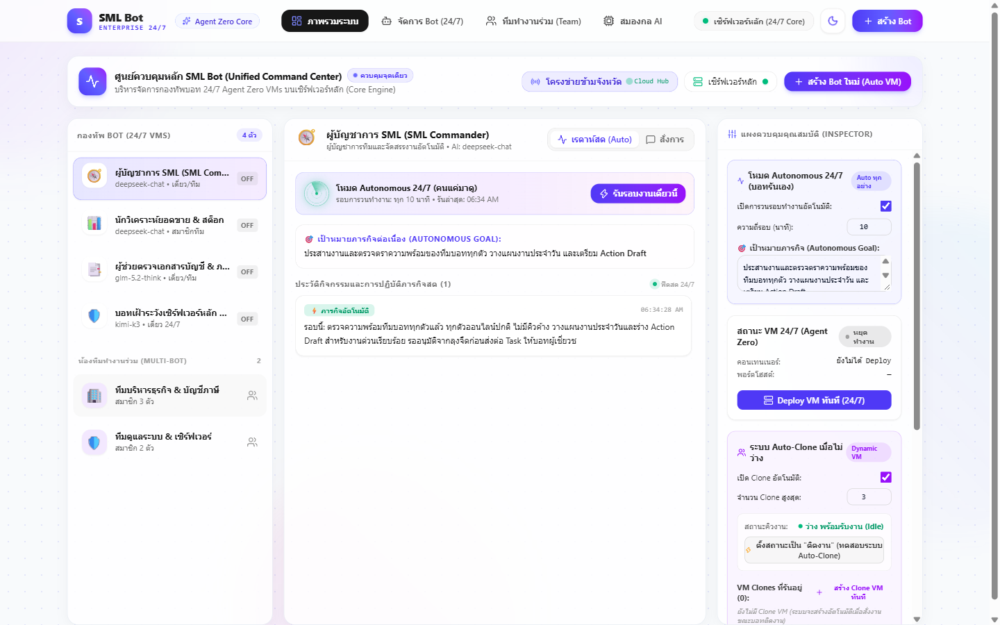 |

### 2. สั่งการบอทผ่านแชท
ระหว่างที่ AI กำลังคิดจะมีคลื่นพัลส์ (Pulse Wave) แสดงสถานะ พอตอบเสร็จจะบอกด้วยว่าใช้โมเดลไหนตอบ

| AI กำลังประมวลผล | AI ตอบกลับ |
|---|---|
| 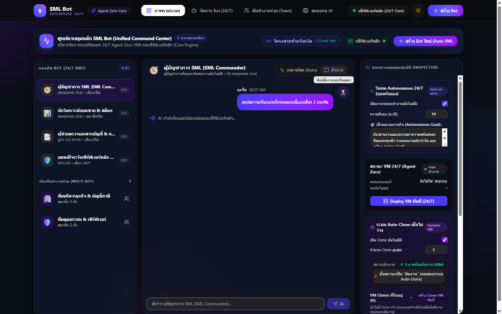 | 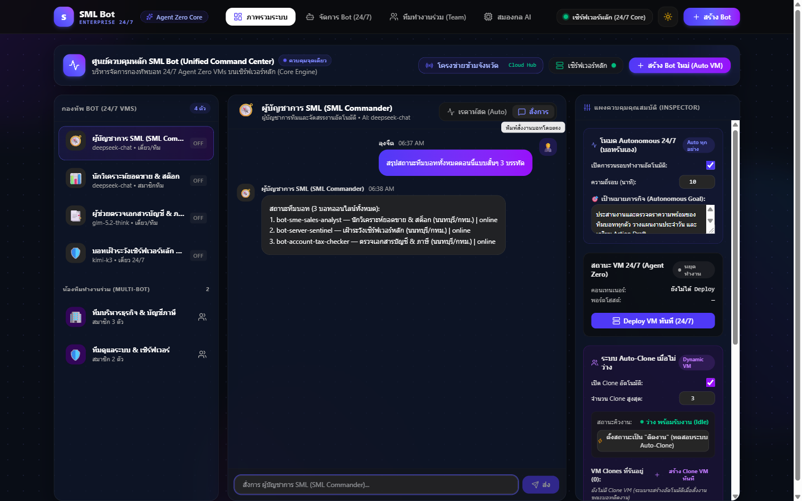 |

### 3. ส่งภารกิจข้ามจังหวัด (Cross-Province Dispatch)
สั่งผู้บัญชาการให้ส่งงานไปหาบอทอีกตัว ระบบจะร่างภารกิจไว้รออนุมัติก่อน กดอนุมัติเมื่อไรงานจึงถูกส่งเข้า Kafka topic `smlbot.tasks`

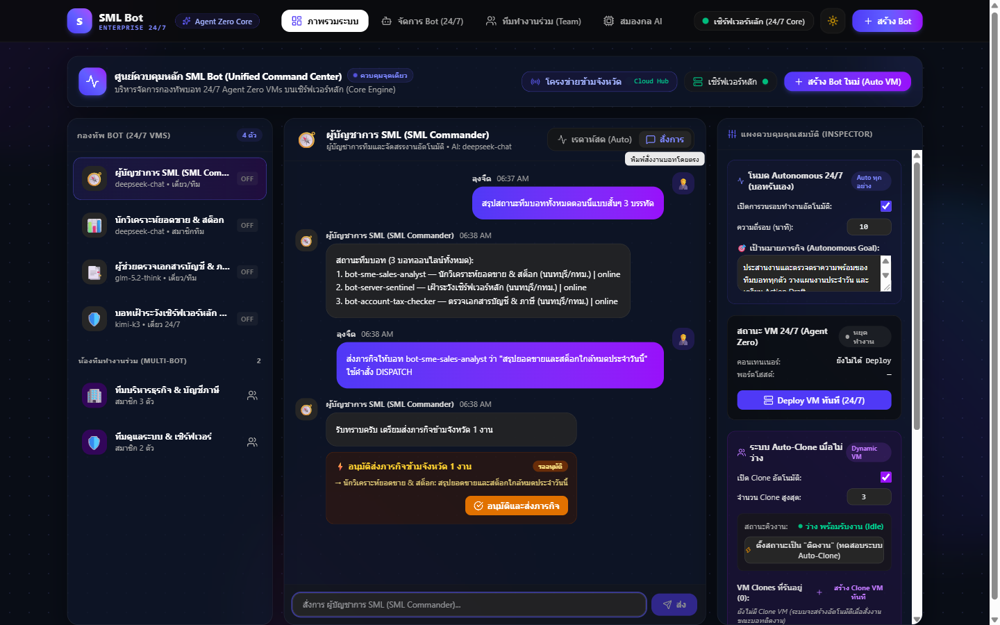

### 4. โครงข่ายสื่อสารข้ามจังหวัด (Cloud Hub)
ดูสถานะ Redis (State & Heartbeat) กับ Kafka (Event Stream) และรายชื่อบอทที่ออนไลน์อยู่แต่ละจังหวัด หน้าจอจะแสดงแค่ชื่อโครงข่ายและเลขพอร์ต ไม่แสดง IP

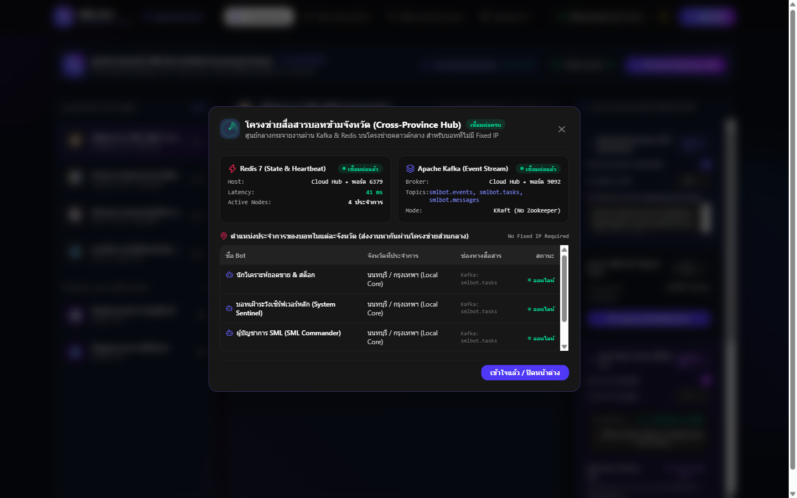

### 5. ห้องทีมทำงานร่วม (Multi-Bot Team Room)
หัวหน้าทีมกับลูกทีมตอบต่อกันตามลำดับ (sequential) ในห้องเดียวกัน

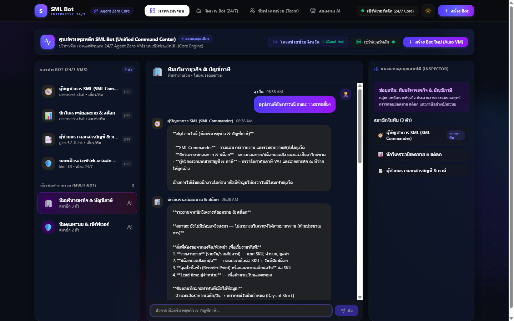

### 6. จัดการ Bot (24/7)
| รายการ Bot (มืด) | รายการ Bot (สว่าง) |
|---|---|
| 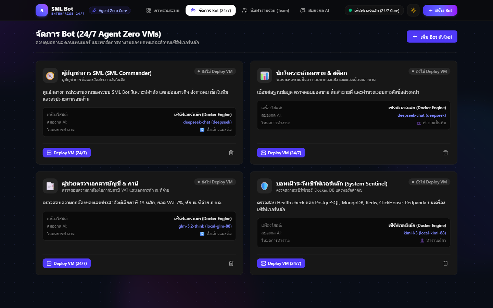 | 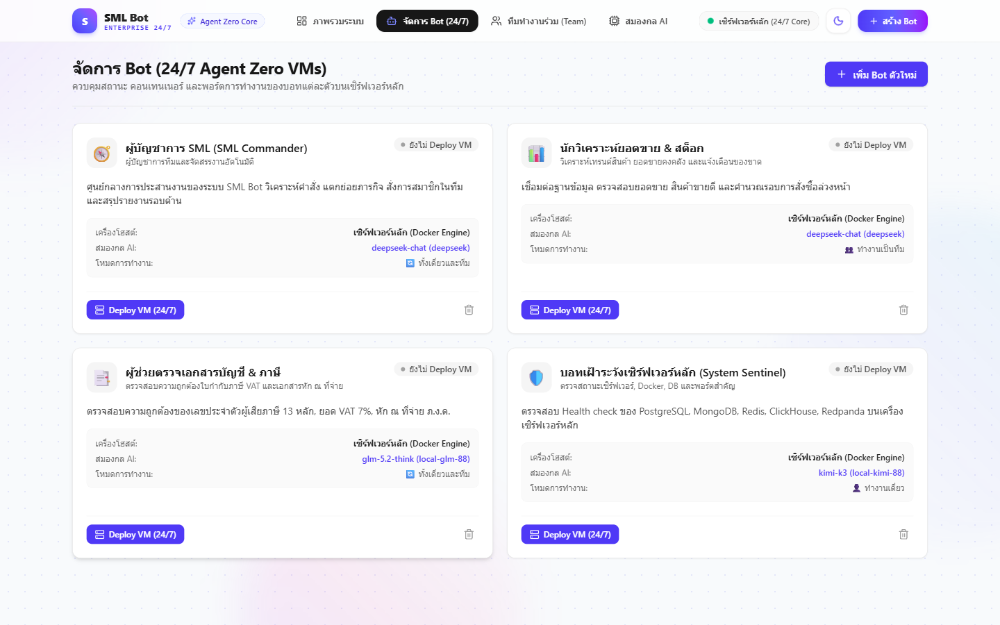 |

| สร้าง Bot ใหม่ (Auto VM) | หน้าสร้าง Bot แบบเต็ม |
|---|---|
| 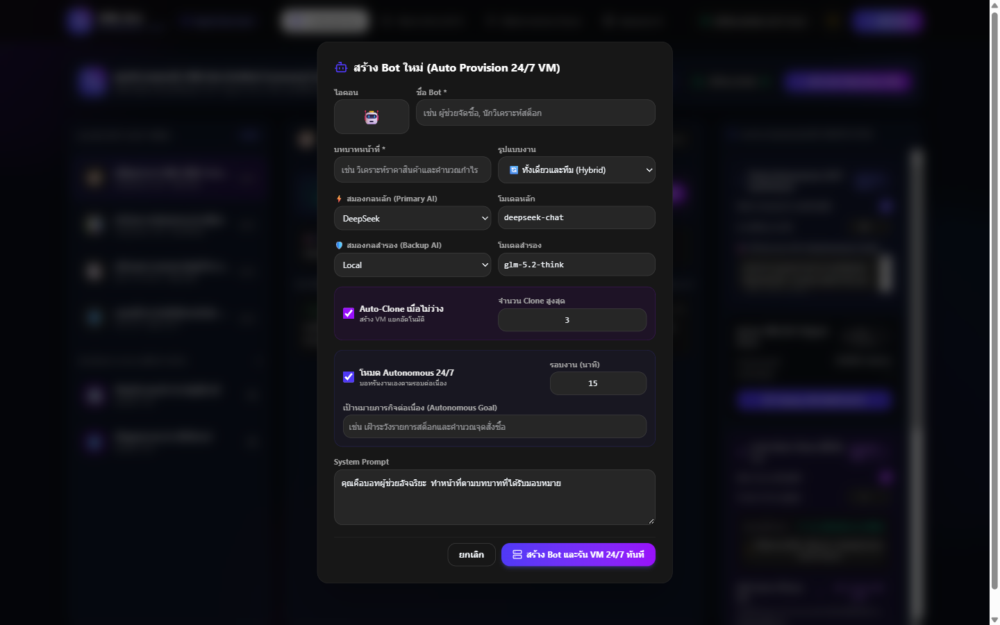 | 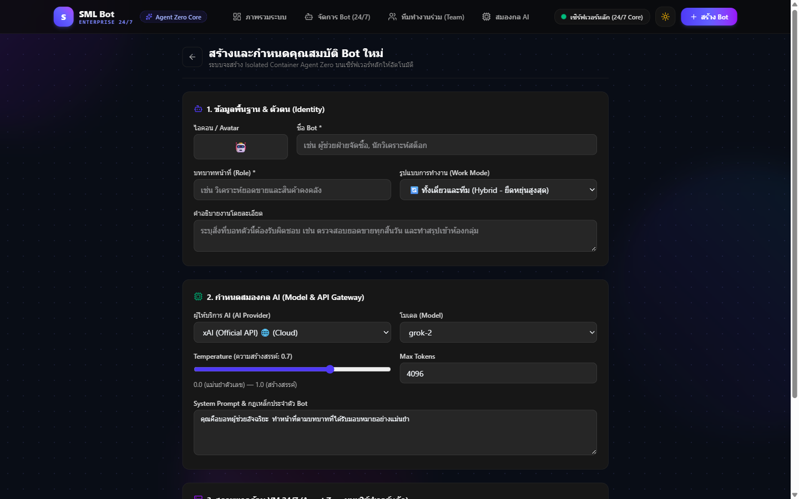 |

### 7. ทีมทำงานร่วม (Groups)
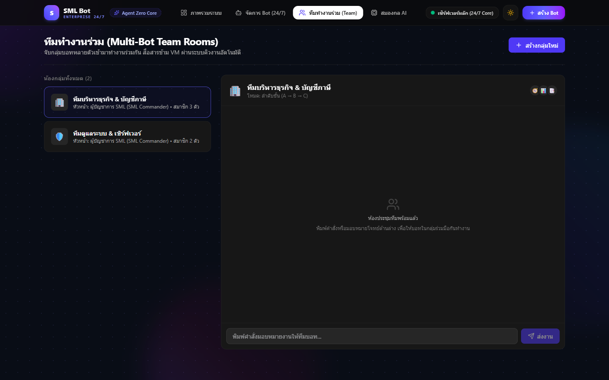

### 8. สมองกล AI (AI Providers & API Gateway)
API Key แสดงเป็น `•••••••••••••••• (ปลอดภัย)` ส่วน IP ภายในจะถูกซ่อนเป็น `core.local` ตั้งแต่ฝั่งเซิร์ฟเวอร์

| โหมดมืด | โหมดสว่าง |
|---|---|
| 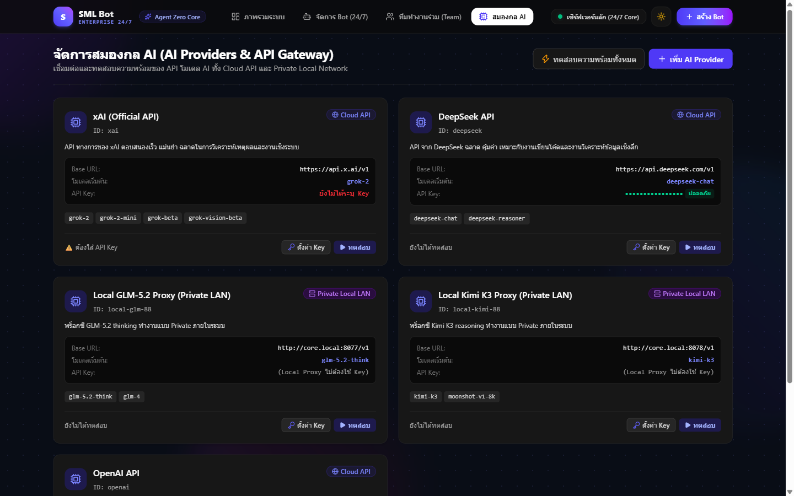 | 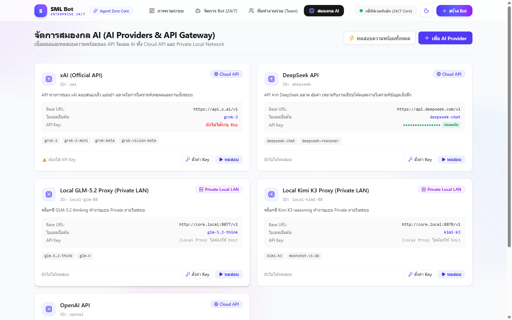 |

---

## Objective
- รวมการสร้าง สั่งการ และเฝ้าดูบอท AI ทุกตัวไว้ในหน้าเดียว ได้แก่ Monitor, สั่งการ (Chat) และ Live VM (Terminal)
- รันบอทแต่ละตัวเป็น Agent Zero container แยกกัน 24/7 (พอร์ต 50001 ขึ้นไป) และเมื่อบอทติดงานอยู่ ระบบจะ Auto-Clone ให้
- ให้บอทข้ามสาขา/จังหวัดคุยและส่งงานหากันผ่าน Redis + Kafka บน Cloud Hub
- กันระบบล่มจาก AI ตัวเดียว ด้วยหลัก *"ถ้า AI สำรองไม่ทำงาน ให้หาตัวที่ทำงานได้มาทำแทน"*

---

## สถาปัตยกรรม

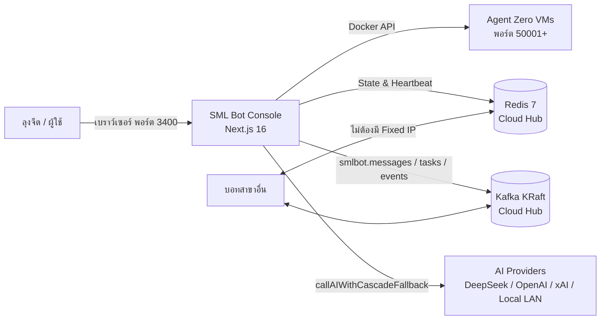

### AI Multi-Tier Cascade Failover (`src/lib/ai-gateway.ts`)

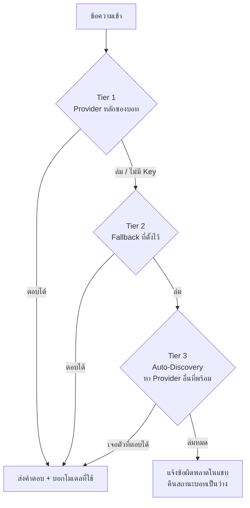

### ส่งภารกิจข้ามจังหวัด

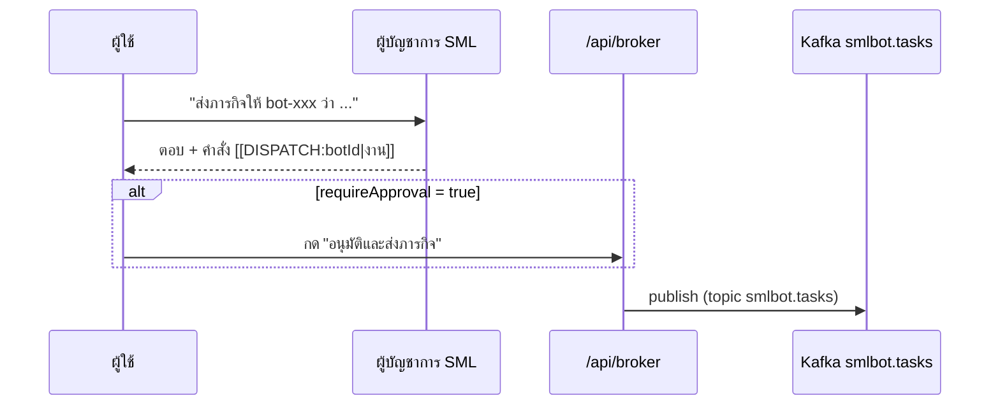

---

## Workflow
1. **สร้าง Bot**: กด "สร้าง Bot ใหม่ (Auto VM)" แล้วเลือก AI Provider/โมเดล ถ้าติ๊ก Deploy ทันที ระบบจะสร้าง container ให้ในคำขอเดียว
2. **ตั้งสมองกล**: เข้าหน้า "สมองกล AI" แล้วกด "ตั้งค่า Key" กับ "ทดสอบ" ทีละ Provider หรือกด "ทดสอบความพร้อมทั้งหมด" ทีเดียว
3. **สั่งงาน**: ที่หน้า "ภาพรวมระบบ" เลือกบอท แล้วเลือกแท็บที่ต้องการ
   - **เรดาร์สด (Auto)**: ดูรอบงานอัตโนมัติ
   - **สั่งการ**: แชทสั่งบอท
   - **Live VM**: เปิดหน้า Agent Zero ของบอทนั้น (มีปุ่ม Fullscreen/รีเฟรช)
4. **Autonomous 24/7**: เปิดที่แผงควบคุม (Inspector) แล้วตั้งความถี่ (นาที) กับเป้าหมาย ตัวจับเวลาจะเช็กทุก 60 วินาทีว่าบอทตัวไหนถึงรอบแล้ว
5. **ทีมทำงานร่วม**: สร้างกลุ่มโดยกำหนดหัวหน้า ลูกทีม และโหมด แล้วสั่งงานในห้องทีม ถ้าบอทร่าง Action Draft มา ให้กดอนุมัติในห้องนั้น
6. **ข้ามจังหวัด**: สั่งงานให้บอทตามรูปแบบ `[[DISPATCH:<botId>|<งาน>]]` ถ้าเปิด requireApproval ไว้ ระบบจะรอให้กดอนุมัติก่อนส่ง

---

## Config

คัดลอก `.env.example` ไปเป็น `.env` แล้วใส่ค่าจริง ไฟล์ `.env` ถูก gitignore/dockerignore ไว้แล้ว ห้าม commit

| ตัวแปร | ความหมาย | ค่าเริ่มต้น |
|---|---|---|
| `BROKER_REDIS_HOST` | host ของ Redis บน Cloud Hub | — |
| `BROKER_REDIS_PORT` | พอร์ต Redis | `6379` |
| `BROKER_REDIS_PASSWORD` | รหัสผ่าน Redis | — |
| `BROKER_KAFKA_HOST` | `host:port` ของ Kafka | — |
| `AUTONOMOUS_SCHEDULER` | `off` = ปิดตัวจับเวลา Autonomous (ทำงานเฉพาะ production) | `on` |
| `DEEPSEEK_API_KEY` / `OPENAI_API_KEY` / `XAI_API_KEY` | Key ตั้งต้นของแต่ละ Provider (ตั้งผ่านหน้าเว็บแทนได้) | ว่าง |
| `LOCAL_GLM_URL` / `LOCAL_KIMI_URL` | URL ของ Local Proxy ในวง LAN | `http://127.0.0.1:8077/v1`, `:8078/v1` |
| `USE_SSH_DOCKER` | `true` = สั่ง Docker ผ่าน SSH ไปที่เซิร์ฟเวอร์หลัก | `false` ใน compose |
| `REMOTE_DOCKER_HOST` | `user@host` สำหรับโหมด SSH Docker | ดู `src/lib/vm-orchestrator.ts` |

ข้อมูลระบบเก็บเป็นไฟล์ JSON ใน `data/` (ใน Docker คือ volume `/home/smlsoft/smlbot/data`) ได้แก่ `bots.json`, `groups.json`, `ai-providers.json` ไฟล์พวกนี้มี API Key อยู่ จึงถูก gitignore และ dockerignore ไว้

---

## Dependency
- Node.js 24 (ตาม `Dockerfile`) และ pnpm 10
- Next.js 16.4.3 (App Router, Turbopack) และ Tailwind CSS v4
- `ioredis` (Redis 7) และ `kafkajs` (Kafka KRaft)
- Docker + Docker Compose บนเซิร์ฟเวอร์หลัก ใช้สร้าง Agent Zero VM ผ่าน `/var/run/docker.sock`
- ต้องมี AI Provider อย่างน้อย 1 ตัวที่ใช้ได้ (แนะนำ DeepSeek `deepseek-chat`)

---

## Usage example

```bash
pnpm install
```

```bash
cp .env.example .env
```

```bash
pnpm dev
```
แล้วเปิด http://localhost:3000

Build สำหรับ production:
```bash
pnpm build
```

Deploy ขึ้นเซิร์ฟเวอร์หลัก (ส่งซอร์สผ่าน SSH แล้วสั่ง `docker compose up -d --build` ให้ โดยไม่ส่ง `.env` กับ `data/` ไปด้วย):
```bash
SMLBOT_HOST=user@your-server ./deploy.sh
```

ตัวอย่างเรียก API ตรง เช่น สร้างบอทแบบยังไม่ Deploy VM:
```bash
curl -X POST http://localhost:3000/api/bots -H "Content-Type: application/json" -d '{"name":"ผู้ช่วยจัดซื้อ","role":"ดูแลใบสั่งซื้อ","providerId":"deepseek","modelName":"deepseek-chat","deployVM":false}'
```

---

## API

| Route | Method | หน้าที่ |
|---|---|---|
| `/api/bots` | GET, POST | รายการบอท / สร้างบอท (มี validation; `deployVM:false` = ยังไม่สร้าง container) |
| `/api/bots/[id]` | GET, PUT, DELETE | ดู / แก้แบบ whitelist field / ลบ (ลบ container, ถอดออกจากกลุ่มและ Cloud Hub registry ด้วย) |
| `/api/bots/[id]/chat` | POST | สั่งการบอท (cascade failover, auto-clone, DISPATCH) |
| `/api/bots/[id]/vm` | POST | `deploy`, `start`, `stop`, `restart`, `status`, `spawn_clone`, `remove_clone` |
| `/api/groups` | GET, POST | รายการ / สร้างทีม (หัวหน้าทีมถูกใส่เป็นสมาชิกอัตโนมัติ) |
| `/api/groups/[id]/chat` | POST | สั่งงานห้องทีม |
| `/api/ai-providers` | GET, POST | รายการ Provider (ซ่อน Key และ IP) / เพิ่ม Provider |
| `/api/ai-providers/[id]` | GET, PUT, DELETE | ดู / แก้ / ลบ Provider |
| `/api/ai-providers/[id]/test` | POST | ทดสอบความพร้อมของ Provider |
| `/api/broker` | GET, POST | สถานะ Cloud Hub + รายชื่อโหนด / `heartbeat`, `send` (เฉพาะ topic `smlbot.*` ที่กำหนด) |
| `/api/autonomous` | GET, POST | สถานะ / สั่งรันรอบงานอัตโนมัติทันที |

---

## ความปลอดภัย
- หน้าจอไม่แสดง API Key จริง ฝั่งเซิร์ฟเวอร์ส่งกลับเป็นค่า mask กับ `hasKey` เท่านั้น
- ซ่อน IP ภายในเป็น `core.local` ตั้งแต่ API (`maskBaseUrl` ใน `src/lib/ai-store.ts`) ถ้าแก้ Provider แล้วส่งค่าที่ mask กลับมา ระบบจะไม่เอาไปเขียนทับ URL จริง
- `.env*`, `data/`, `*.pem`, `*.key`, `credentials*.json` ถูกกันไว้ทั้งใน `.gitignore` และ `.dockerignore`
- ทุก API ตรวจ input (ชนิด/ช่วง/ความยาว) และรับแก้เฉพาะ field ที่อนุญาต จึงกัน mass-assignment `vmConfig`/`isBusy` ได้

---

## Limitation
- **API ยังไม่มีระบบยืนยันตัวตน**: ใช้ได้เฉพาะในวง LAN หรือหลัง VPN/Reverse Proxy ที่มี auth เท่านั้น ห้ามเปิดออกอินเทอร์เน็ตตรง
- **ยังไม่มีตัวรับงานฝั่ง `smlbot.tasks`**: Console ส่งภารกิจเข้า Kafka ได้แล้ว แต่ยังไม่มี consumer ที่ดึงงานไปให้บอทปลายทางทำอัตโนมัติ
- **Clone เป็นช่องรับงานพร้อมกัน**: AI ยังประมวลผลที่ Console เป็นหลัก ส่วน Clone container มีไว้ขยายช่องทำงานและแสดงสถานะ
- **Autonomous เรียก AI จริงตามรอบ** จึงมีค่าใช้จ่าย ปิดได้ด้วย `AUTONOMOUS_SCHEDULER=off`
- **โมเดลของ xAI** ใช้รหัสโมเดลตามที่ xAI กำหนด จึงขึ้นอยู่กับรุ่นที่ xAI เปิดให้ใช้อยู่ตอนนั้น
- **สั่ง Docker แบบ local บน Windows** ไม่รองรับ เพราะคำสั่งใช้ quoting แบบ Linux ให้รัน Console บน Linux หรือใช้โหมด SSH Docker แทน
- รันโหมด dev จะส่ง heartbeat ของบอทเข้า Cloud Hub registry จริง (TTL 90 วินาที)
